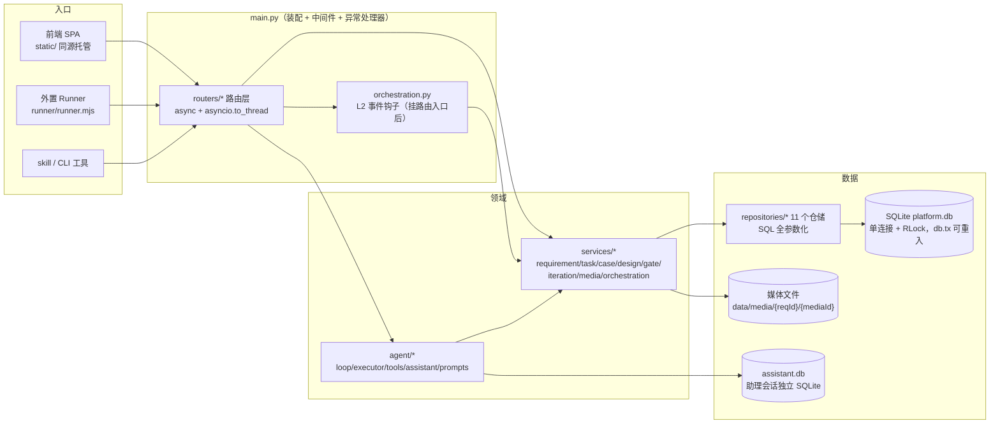
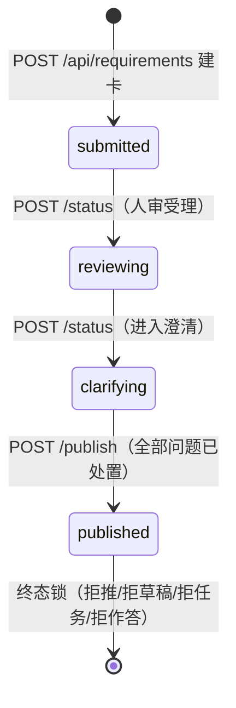
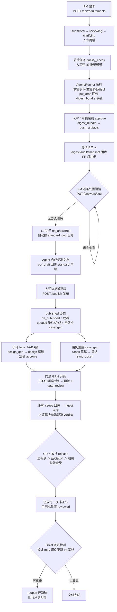
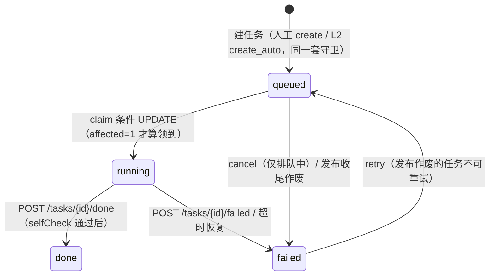
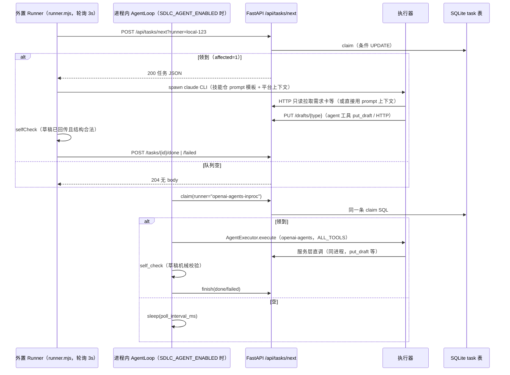
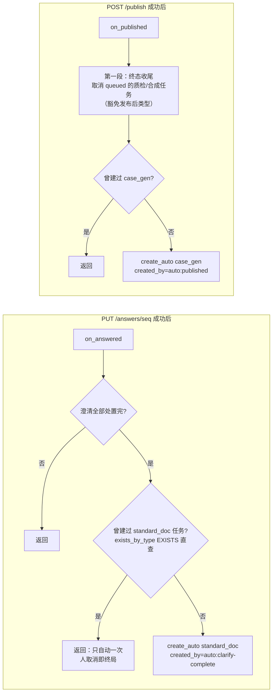
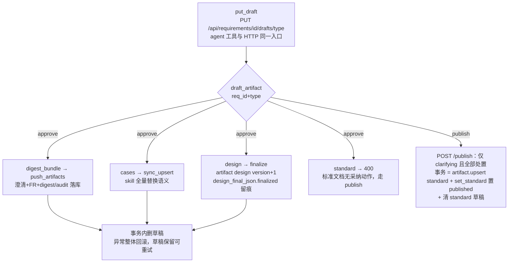
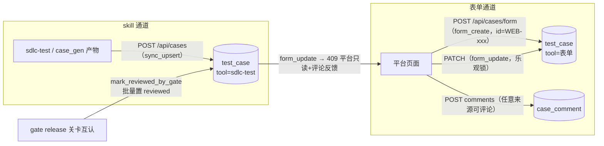
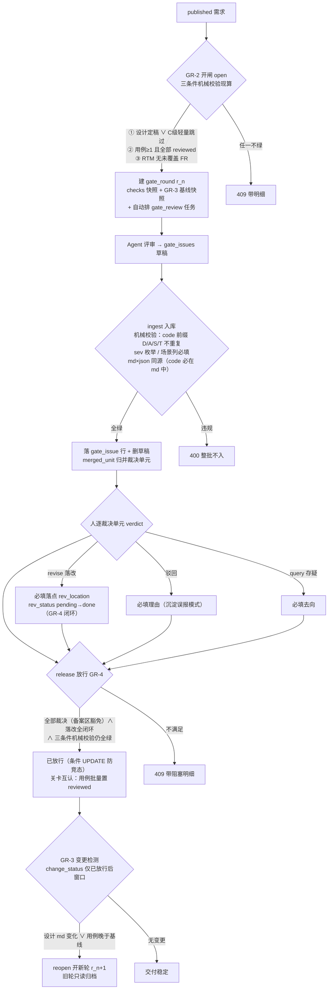

# SDLC 产物协作平台 —— ER 图与业务流程（技术侧）

> 依据：`src/platform_sdlc/` 当前代码（main / routers / services / repositories / agent）+ `schema.sql` + `runner/runner.mjs`。
> **契约权威（2026-10 起生效）**：人读契约 = 本文 §13 端点速览表；机器可读契约 = `docs/openapi.json`
> （`scripts/export-openapi.mjs` 导出，契约面变更须随批次重跑并 commit）。`docs/DEV-PLAN.md` 已归档为
> v1 历史文档（停留 Java v1 时代，勿据其开发——AUDIT D1-1）。
> 生成日期：2026-10-12。

---

## 0. 一句话模型

单服务（FastAPI）+ 单库（SQLite 单连接单写者）+ 任务队列双执行通道（外置 Runner spawn `claude` CLI / 进程内 openai-agents）。
产物一律走 **草稿（draft）→ 人工采纳/发布（approve/publish）** 两态，agent 对正式产物**没有写通道**。
域模型：**需求卡（requirement）是唯一聚合根**，其余实体全部挂在 `req_id` 下；无外键约束，关系靠服务层守卫保证。

---

## 1. 系统装配与分层

### 1.1 装配链

`main.create_app()`（`main.py:34`）：

```
Settings → resolve_paths（data/ 等，依赖 cwd=仓根）
→ run_migrations（幂等：schema.sql IF NOT EXISTS + migrations.py 判列补列）
→ Repos.create(db)           # 11 个仓储
→ Services.create(db, repos, media_dir)   # 8 个服务（services/__init__.py:32）
→ AppContext（runtime.py，路由层唯一共享对象）
→ _install_exception_handlers → _install_middleware（X-Token 写守卫 + 静态缓存）
→ register_routers → _mount_static（SPA 同源托管）
lifespan：SDLC_AGENT_ENABLED=true 时启动 AgentLoop（进程内执行通道）
```

### 1.2 分层单向依赖



硬规矩（CLAUDE.md）：

- 分层单向：main → routers → services → repositories → models；routers 不碰仓储。跨域流程汇聚点 =
  `orchestration.py`（作答/发布/开闸三钩子，挂路由成功后）+ `task.approve`（草稿采纳分流）；
  保留互调：`task.create_guarded → designs.assert_gen_allowed`（写面守卫）、`gate.checks → designs.view`（读面）；
  `gate.open` 事务内保留 `count_active` 预判承担「建轮与排评审任务」的原子性守卫（对抗审查 M1）。
- async 路由里的同步服务调用一律 `asyncio.to_thread(...)`——SQLite/文件 IO 不冻结事件循环（进程内 agent 轮询、助理 SSE 与请求共享同一循环）。
- 循环体内无数据库查询（如 `sync_upsert` 的 case_no 批量预分配、`next_id` 一次性取号）。

---

## 2. ER 图

### 2.1 全量实体关系（13 张表）

SQLite **不建外键**：实线表示服务层维护的逻辑归属；`iteration→requirement` 是弱引用（`requirement.iter` 指向迭代名，1:1 由服务层守卫 + 存活行检测保证）；`test_case.points` 对 `fr_point.id` 是 JSON 数组内的引用（RTM 覆盖率的计算依据，非 SQL 关系）。

```mermaid
erDiagram
    ITERATION["iteration 迭代"] {
        TEXT name PK "迭代名即主键，≤64字"
        TEXT note "备注 ≤200字"
        TEXT created_by "创建人 ≤40字"
        TEXT created_at
    }
    REQUIREMENT["requirement 需求卡"] {
        TEXT id PK "REQ-年-序号（REQ-2026-001），软删编号不复用"
        TEXT name "需求名 ≤120字"
        TEXT iter "弱引用 iteration.name；存活需求按 iter 唯一（1:1）"
        TEXT source_type "feishu | text"
        TEXT source_url "飞书来源必填"
        TEXT source_text "text 来源必填（原文全文）"
        TEXT status "submitted | reviewing | clarifying | published"
        TEXT submitted_by
        TEXT standard_doc "已发布标准文档 md 快照"
        TEXT created_at
        TEXT synced_at "skill 最近同步时间"
        TEXT domains "关注域（读时推导落库）"
        TEXT deleted_at "软删除打标，空=存活"
        TEXT risk_tier "A | B | C（空=未分级按 A）"
        TEXT target_repo "目标仓（首仓镜像，v2.3 遗留）"
        TEXT design_final_json "设计域留痕：finalized/skipDeclared/tierProposal"
        TEXT target_repos "多目标仓清单 JSON（D39）"
    }
    CLARIFY_ITEM["clarify_item 澄清项"] {
        INTEGER id PK "AUTOINCREMENT"
        TEXT req_id FK "归属需求"
        TEXT seq UK "处置唯一键，[A-Za-z0-9._-]{1,32}；UNIQUE(req_id,seq)"
        TEXT level "red | yellow | blue"
        TEXT theme "主题（关注域）"
        TEXT question "问题文本（重推保留已答的比对键）"
        TEXT ctx "上下文"
        TEXT answer "答复内容"
        TEXT answered_at "最近处置时间"
        TEXT quote "原文引用"
        TEXT anchor "块级锚点"
        TEXT status "pending | answered | rejected | deferred"
        TEXT note "处置备注（驳回必填理由）"
    }
    ARTIFACT["artifact 正式产物"] {
        TEXT req_id PK "复合主键 (req_id,type)"
        TEXT type PK "digest | audit | snapshot | standard | design"
        TEXT markdown "正式产物正文"
        TEXT content_json "结构化侧车（digest/audit 视图等）"
        INTEGER version "乐观递增"
        TEXT pushed_at
    }
    FR_POINT["fr_point 需求点"] {
        TEXT req_id PK "复合主键 (req_id,id)"
        TEXT id PK "功能点编号（FR-xx，digest 推送注册）"
        TEXT name
        TEXT source
        TEXT group_name "分组"
        TEXT module
        TEXT anchor
    }
    MEDIA["media 媒体"] {
        TEXT req_id PK "复合主键 (req_id,media_id)"
        TEXT media_id PK "m-+sha256前12位；显式 id 须同格式"
        TEXT sha256 "内容寻址，兼 ETag"
        TEXT name
        TEXT mime
        INTEGER bytes
        TEXT created_at
    }
    TEST_CASE["test_case 测试用例"] {
        TEXT req_id PK "复合主键 (req_id,id)"
        TEXT id PK "skill 自带编号；表单通道 WEB-xxx"
        TEXT title
        TEXT points "JSON 数组：引用 fr_point.id（RTM 覆盖）"
        TEXT priority "P0 | P1 | P2（skill 非法宽容归一 P2）"
        TEXT pre "前置"
        TEXT steps
        TEXT expect
        TEXT owner
        TEXT tool "sdlc-test | 表单 —— 决定读写通道"
        TEXT status "draft | reviewed"
        INTEGER version "乐观锁版本"
        TEXT created_at
        TEXT updated_at
        TEXT verify_refs "JSON：验证引用（R2/R4 可选）"
        TEXT defect_refs "JSON：缺陷引用"
        INTEGER case_no "全局单调序号（seq_case_no 发号）"
    }
    CASE_COMMENT["case_comment 用例评论"] {
        INTEGER id PK "AUTOINCREMENT"
        TEXT req_id FK
        TEXT case_id FK "逻辑引用 test_case(req_id,id)"
        TEXT by
        TEXT text
        TEXT created_at
    }
    TASK["task 任务"] {
        INTEGER id PK "AUTOINCREMENT"
        TEXT req_id FK
        TEXT type "quality_check | standard_doc | case_gen | design_gen | design_rev | gate_review"
        TEXT status "queued | running | done | failed"
        TEXT payload "JSON（note 等）"
        TEXT result "JSON（done 摘要 / failed 错误+reason+hint）"
        TEXT runner "领取者：local-<pid> / openai-agents-inproc"
        TEXT created_by "空=人工；auto:clarify-complete | auto:published | gate:open"
        TEXT created_at
        TEXT updated_at "超时恢复的判断依据"
    }
    DRAFT_ARTIFACT["draft_artifact 草稿"] {
        TEXT req_id PK "复合主键 (req_id,type)"
        TEXT type PK "digest_bundle | standard | cases | design | gate_issues"
        TEXT md "markdown 载体"
        TEXT content_json "payload 载体（digest_bundle 必填）"
        INTEGER task_id "回传来源任务（可空）"
        TEXT updated_at
    }
    SEQ_CASE_NO["seq_case_no 用例序号发号器"] {
        INTEGER id PK "恒为 1（单行发号器）"
        INTEGER val "case_no 当前值（全局跨需求单调）"
    }
    GATE_ROUND["gate_round 评审轮"] {
        INTEGER id PK "AUTOINCREMENT"
        TEXT req_id FK
        INTEGER round_no "UNIQUE(req_id,round_no)，r1/r2/…"
        TEXT status "pending | released（权威两值；2026-10 英文化，存量中文值经 SchemaMigrator 迁移）"
        TEXT checks_json "开闸三条件快照"
        TEXT baseline_json "GR-3 基线：设计终稿全文+用例 maxUpdated"
        TEXT released_at
        TEXT released_by
        TEXT created_by "开闸人"
        TEXT opened_at
    }
    GATE_ISSUE["gate_issue 评审issue"] {
        INTEGER id PK "AUTOINCREMENT"
        INTEGER round_id FK "归属评审轮"
        TEXT code "D-分歧/A-架构/S-数据/T-可测性 前缀，如 S-01"
        TEXT sev "high | mid | low"
        TEXT theme
        TEXT role
        TEXT scene "白话场景（必填）"
        TEXT quote "引用原文"
        TEXT loc "位置"
        TEXT basis "soft 等"
        INTEGER div_flag "分歧标记"
        INTEGER tradeoff "权衡标记"
        INTEGER merged_unit "裁决单元（同单元批量同裁）"
        INTEGER filed "备案区（放行校验豁免）"
        TEXT verdict "revise(落改) | reject(驳回) | query(存疑)；空 = 备案区（读面推导 filed）"
        TEXT verdict_note "reject=理由 / query=去向"
        TEXT verdict_by
        TEXT verdict_at
        TEXT rev_location "落改落点（<文件+位置>）"
        TEXT rev_status "待执行 | 已执行"
    }

    ITERATION ||--o| REQUIREMENT : "iter 弱引用，存活 1:1"
    REQUIREMENT ||--o{ CLARIFY_ITEM : "澄清清单（重推全量替换）"
    REQUIREMENT ||--o{ ARTIFACT : "正式产物（按 type）"
    REQUIREMENT ||--o{ FR_POINT : "需求点注册（replace_all）"
    REQUIREMENT ||--o{ MEDIA : "原文媒体"
    REQUIREMENT ||--o{ TEST_CASE : "测试用例"
    TEST_CASE ||--o{ CASE_COMMENT : "评论（删用例级联清理）"
    REQUIREMENT ||--o{ TASK : "任务队列"
    REQUIREMENT ||--o{ DRAFT_ARTIFACT : "草稿（按 type）"
    TASK |o--o| DRAFT_ARTIFACT : "task_id 回传来源"
    REQUIREMENT ||--o{ GATE_ROUND : "评审轮（旧轮只读归档）"
    GATE_ROUND ||--o{ GATE_ISSUE : "issue 清单"
    TEST_CASE }o--o{ FR_POINT : "points JSON 引用（RTM，读时聚合不落库）"
```



### 2.2 表职责与关键不变量

| 表 | 职责 | 关键不变量 / 守卫 |
|---|---|---|
| `requirement` | 需求卡聚合根 | id 取号含已软删行（编号永不复用，`requirement_repo.py:35`）；`find()` 一律过滤 `deleted_at=''`（软删需求对服务层整体 404）；发布走 `set_standard` 同步置 `published` |
| `clarify_item` | 澄清问题与处置 | `UNIQUE(req_id,seq)`；seq 同时是 REST 路径段（字符白名单）；处置语义 D21：作答/驳回(rejected)/挂起(deferred)/重开(pending)，**驳回与挂起计入"已处置"**（发布口径） |
| `artifact` | 正式产物（人审后） | 复合主键；`version` 每次写递增；`standard` 只能由 `publish` 写、`design` 只能由设计定稿写 |
| `fr_point` | FR 需求点注册 | 每次质检推送 `replace_all` 全量重建；RTM 正向覆盖 = `test_case.points` 引用即覆盖（读时聚合） |
| `media` | 原文媒体元数据 | 文件体在 `data/media/{reqId}/{mediaId}`；同 mediaId 重复上传幂等返回；`sha256` 兼作 ETag（304 协商缓存 + immutable） |
| `test_case` | 测试用例双通道 | 复合主键；`tool` 决定通道：`sdlc-test`（skill 推送，平台**只读+评论**）/ `表单`（平台可编辑）；`version` 乐观锁；`case_no` 由 `seq_case_no` 单行账本全局发号 |
| `case_comment` | 用例评论 | 删除 skill 用例时评论级联清理（`comment.delete_by_case`） |
| `task` | 任务队列 | `claim` 条件 UPDATE 原子领取；`finish` 仅 `running` 可回报；`exists_by_type` 是 L2"只自动一次"判据（EXISTS 直查，不信 LIMIT 100 窗口） |
| `draft_artifact` | 草稿（agent/skill 回传） | 复合主键 upsert；采纳成功即删（草稿是临时态）；终态锁拒 `digest_bundle/standard` 类草稿 |
| `seq_case_no` | 用例全局序号发号器 | 单行（id=1）账本，批量分配在事务内一次 UPDATE（循环内不查库） |
| `iteration` | 迭代 | 名即主键；与需求 **1:1 = 存活需求按 iter 唯一**（软删自动释放迭代名）；仅空迭代可删（物理删除） |
| `gate_round` | 评审轮 | 权威状态仅两值：pending→released；放行后轮只读；新轮=复审（GR-3），旧轮归档 |
| `gate_issue` | 评审 issue 与裁决 | `merged_unit` 裁决单元：人裁决的是单元，同单元批量同裁；`filed=1` 备案区放行校验豁免；落改闭环 = 落点已填 ∧ `rev_status=done` |

> 模式备注：`schema.sql` 头注明结构以运行库为权威；schema 变更 = 建表加 `IF NOT EXISTS` + `migrations.py` 判列补列（幂等）。反向索引等**读时聚合不落库**。

---

## 3. 需求主生命周期（状态机）



- 状态流转只允许上图画出的四值三跳（`requirement.py:277` `set_status` 白名单），**publish 直达终态不经 set_status**。
- `published` 是**终态**：质检产物拒推（"实质变更请新开一轮流程"）、`digest_bundle/standard` 草稿拒写、`quality_check/standard_doc` 任务拒建、作答拒绝（仅 clarifying 可作答）。豁免面 = `case_gen / design_gen / design_rev / gate_review`（它们本来就是发布后流程，D36 口径统一）。
- 删除是旁路：软删除（`deleted_at` 打标），running 任务先拒 409，queued 任务批量取消，tx 全程持锁堵"running 检查与取消之间被领取"的 TOCTOU 窗口；行与子表原样保留，恢复仅需一条 UPDATE。

---

## 4. 端到端主干流程（大图）



---

## 5. 质检产物推送与澄清处置

### 5.1 push_artifacts（`requirement.py:96`）

入口有两个：HTTP 直推 `POST /api/requirements/{id}/artifacts`（skill/CLI 通道）与草稿采纳（`approve` 的 digest_bundle 分支，事务内转调同一方法）。语义与守卫：

1. **全量替换**：clarify_item 按 req 全删重插、fr_point `replace_all`、digest/audit artifact upsert（snapshot/doc 块可选）。
2. **重推保留已答**（红线）：按 `seq + 问题文本` 匹配携带存量 `answer/status/note`；**seq 相同但问题文本已变（P 编号漂移）不携带**——防旧答复张冠李戴，漂移数计入返回 `changed`。
3. 入参校验：seq 白名单 `[A-Za-z0-9._-]{1,32}`（它是 REST 路径段）；level ∈ red|yellow|blue；items 非空、seq/FR id 批内不重复；published 拒推 409。
4. `doc.media[].id` 与 media 表比对，缺失数记入 `missingMedia`（非阻塞提示）。
5. tx 全程持锁。

### 5.2 澄清处置（`set_answer`，`requirement.py:236`）

`PUT /api/requirements/{req_id}/answers/{seq}`，D21 统一处置入口：

| body.status | 语义 | 守卫 |
|---|---|---|
| （不携带） | 作答：`answer` 非空 → `answered` | 仅 clarifying 状态 |
| `rejected` | 驳回 | **必填 note（理由）** |
| `deferred` | 挂起 | 沿用存量 answer |
| `pending` | 显式重开（驳回/挂起转回待确认，answer 保留） | — |

处置成功后路由层调 `orch.on_answered`（编排失败不连累作答）。

---

## 6. 任务队列与双执行通道

### 6.1 任务类型与 lane 前置（`task.py:70` create_guarded）

| type | 草稿类型（回传） | 前置守卫 |
|---|---|---|
| `quality_check` | `digest_bundle` | 非 published；同类型无 queued/running（count_active 防重） |
| `standard_doc` | `standard` | **必须 clarifying 且澄清全部处置** |
| `case_gen` | `cases` | 发布后流程（需 published） |
| `design_gen` | `design` | 需 published；非 C 级；未声明轻量跳过；已配目标仓（`DesignService.assert_gen_allowed`） |
| `design_rev` | `design` | 需 published；已有定稿设计（落改闭环用） |
| `gate_review` | `gate_issues` | 需 published（与开闸同口径，堵"排队即被发布误作废"缝隙） |

### 6.2 任务状态机



### 6.3 双通道互斥：claim 的原子性（`task_repo.py:44`）

```sql
-- ① 取最老 queued
SELECT id FROM task WHERE status='queued' ORDER BY id LIMIT 1;
-- ② 带 status 谓词的条件 UPDATE，affected=1 才算领取成功
UPDATE task SET status='running', runner=?, updated_at=? WHERE id=? AND status='queued';
```

两个通道（外置 Runner 轮询 / 进程内 AgentLoop）抢同一队列，互斥完全由这条条件 UPDATE 保证——单连接 + RLock 下无竞态窗口。`finish` 同理：`WHERE id=? AND status='running'`，仅 running 可回报终态（0 行 → 409），防竞态覆盖。

### 6.4 双通道时序



两通道执行器对照：

| | 外置 Runner（`runner/runner.mjs`） | 进程内 AgentLoop（`agent/loop.py`） |
|---|---|---|
| 领取者名 | `local-<pid>`（env 可配） | `openai-agents-inproc` |
| 执行体 | spawn `claude` CLI（`~/.local/bin/claude`），prompt 来自技能仓模板 | openai-agents `Agent`（OpenAI 兼容端点，chat_completions） |
| 工具面 | CLI 通过 HTTP API 自助（读 + put_draft） | `ALL_TOOLS` 直调服务层（同进程） |
| 结果识别 | CLI stdout JSON 的 summary/isError | 最终输出中的 `SDLC_TASK_RESULT {…}` 结果行（缺失触发 attempt=2 续跑，不重做已完成步骤） |
| 机械自查 | selfCheck：草稿已回传 + 按类型的结构/长度下限 | self_check：同口径逐条移植（standard ≥200 字；design ≥200 字且含 §0–§8 标头；gate_issues 需 md+contentJson.issues；digest_bundle 需 digest/audit/items） |
| 超时 | TIMEOUT_MIN（默认 30min）SIGKILL + 启动 recoverStale | deadline + asyncio.wait_for + 启动 expire_stale |
| 回归开关 | verify-all.sh 自动暂停（停进程） | `/api/agent/pause` / `/api/agent/resume`（幂等，未启用时返回 stub） |

### 6.5 L2 自动编排（`orchestration.py`，确定性事件钩子）

挂在两个路由入口（主操作成功后调用，不在领域服务内挂钩避免服务成环）：



铁律：守卫全继承（`create_auto` → `create_guarded`）；**只自动一次**（该类型任务一旦存在即不再自动建——用 `exists_by_type` EXISTS 直查而非 list LIMIT 100 窗口，防任务溢出窗口后已取消任务"复活"）；编排异常一律吞掉记日志，绝不连累人的主操作。

---

## 7. 草稿两态与采纳 / 发布

产物唯一进入正式库的通道：**草稿 → 人审关口（approve / publish）**。agent 工具面不存在正式产物写入。



- `put_draft`（`task.py:179`）：类型白名单五值；**终态检查与写同事务**（堵"检查后发布、发布后落草稿"TOCTOU）；published 拒 `digest_bundle/standard`，豁免 `cases/design/gate_issues`；`digest_bundle` 必须携带 contentJson（完整推送 payload）。
- `approve`（`task.py:221`）：副作用与删草稿同事务（内层 tx 可重入加入外层）；`standard` 是例外——发布本身就是终态动作。
- `publish`（`requirement.py:259`）：三语句原子（写 standard artifact + 置 published + 清 standard 草稿），防半发布态；成功后挂 `on_published`。

---

## 8. 用例域

### 8.1 双通道数据流



### 8.2 sync_upsert 语义（`case.py:23`）

1. **skill 来源全量替换**：不在 payload 中的 `sdlc-test` 用例同步删除（含评论级联）；**表单用例不归 skill 管，一律保留**。
2. **乐观锁**：`expectedVersion` 提供（≥0）且与库内不符 → 整批拒绝 `409 + conflicts` 明细（`{id, currentVersion, expectedVersion}`）；`-1` = 不带版本强制覆写哨兵。版本谓词用**锁内读到的版本**而非调用方声明值，UPDATE 0 行同样 409。
3. `case_no` 全局序号：批量一次分配（单条 UPDATE 账本 + 内存自增，循环内不查库）。
4. 机器输入宽容：非法 priority 归一 P2 并计数 `normalizedPriority`（与人严格 400 相对）；`idWarnings` 提示编号歧义（normalize 后相同但原 id 不同），不改写 id。
5. 入参防御：items 非数组 / expectedVersion 非整数 / 同批重复 id → 400 整批零写入。

### 8.3 表单通道与只读面

- `form_update`：`tool != '表单'` → 409「该用例由 X 推送维护，平台只读；修改请评论反馈维护人」。前置版本检查 + 事务内谓词 UPDATE 双保险，文案一致。
- 评论通道对任意来源用例畅通（对 sdlc-test 来源的协作方式）。

---

## 9. 设计 lane（v2.4 D34/D39）

读面 `GET /api/requirements/{id}/design` 推导 `phase` 四态：`none → draft → final`，旁路 `skipped`：

- **目标仓**：`PUT /target-repos` 多仓全量替换（D39），首仓镜像进 `target_repo`；`design_gen` 前置要求至少 1 条（存量勘察需要）。
- **轻量跳过**：`POST /design/skip` 仅 C 级；与设计草稿/定稿互斥；声明后 `design_gen` 拒绝，门禁以自查档执行；留痕于 `design_final_json.skipDeclared`。
- **生成/修订**：`design_gen`（首产）/ `design_rev`（GR-4 落改闭环，任务 payload 携带落改工作项）→ `design` 草稿 → `approve` 定稿：`artifact(design)` version+1 承接落改修订 + `finalized` 留痕。
- 风险分级 `risk_tier` A|B|C：A/B 走设计 lane，C 走轻量路径（不产设计文档）。

---

## 10. 门禁域（v2.4 D35，GR-2/3/4）

落库权威两值（pending｜released，revise/reject/query 裁决值同批英文化），六态为读面推导；旧轮只读归档。



要点：

- **GR-2 三条件是"现算"**（不信任旧快照），开闸与放行共用同一 `checks()`；`ingest`/`verdict`/`release` 对已放行轮一律 409 只读。
- **裁决单元**：`merged_unit>0`，未合并条目各自成单元；`apply_verdict` 按 `(round_id, merged_unit)` 批量落——人裁决的是单元不是单条。
- **关卡互认**：release 顺带 `mark_reviewed_by_gate` 将该需求用例批量置 `reviewed`（GR-2 条件②的来源之一）。
- **GR-3 两窗口口径**：评审中的变更走落改通道不开新轮；只有「已放行后」窗口才出变更横幅、人确认 reopen。

---

## 11. Agent 工具面与查询助理

### 11.1 任务 Agent 工具面（`agent/tools.py:297` ALL_TOOLS）

| 工具 | 面 | 说明 |
|---|---|---|
| `get_requirement_card` | 只读 | 需求卡：状态/分级/来源/原文全文/已发布标准文档 |
| `list_clarify_items` | 只读 | 澄清清单（含已答） |
| `get_digest_bundle` | 只读 | 质检产物 digest |
| `get_design_doc` | 只读 | 设计终稿/草稿 |
| `list_cases` | 只读 | 用例列表 |
| `put_draft` | **写（唯一产物通道）** | 五类草稿；大内容走 `mdPath/contentJsonPath` 文件中介（磁盘读写防上下文膨胀） |
| `upload_media` | 写（媒体） | mediaId 必须与 `doc.media[].id` 一致 |
| `read_file` / `write_file` / `run_command` | 工作区文件 | 锁定工作区 + 技能仓内解析（防越界），输出上限防上下文膨胀 |

红线：**写入仅 `put_draft` 与 `upload_media`**——正式产物无 agent 写通道，唯一人道是平台「采纳/发布」。守卫拒绝（非法类型/终态锁 409）以错误文本回灌模型。

执行环境（`agent/executor.py`）：工作区 `<agent_workspace_root>/sdlc/<需求名安全化>`；指令 = `sys_prompt(任务类型, 需求, 技能仓, 目标仓清单)`；目标提示 = `goal_prompt(类型) + resume_hint(工作区已有产物盘点不重做)`；`design_rev` 追加任务备注中的落改工作项。

### 11.2 查询助理（`routers/assistant.py` + `agent/assistant.py`）

- `POST /api/assistant/chat`：SSE 流式（`data: {type:"delta",text}` … `{type:"done"}` / `{type:"error"}`）。
- 工具面 `ASSISTANT_TOOLS`（7 个，**跨需求只读**）：search_requirements / get_requirement_summary / list_clarify_items / list_cases / get_gate_status / get_design_status / list_iterations。
- 会话记忆存独立 SQLite `data/assistant.db`（不进 platform.db，单写者模型不变）；会话列表/清除端点齐备。
- 提示词纪律：只答工具能支撑的内容、查不到如实说、引用带编号与状态、数据矛盾指出原始值。
- X-Token：属 POST /api/ 写面，启用 write-token 的部署需带（与 Runner 同口径）。

---

## 12. 横切机制

| 机制 | 实现与口径 |
|---|---|
| **事务模型** | SQLite 单连接 + RLock；`db.tx()` = 服务操作粒度事务，**可重入**（嵌套调用加入外层，approve/publish 的多段写得以同事务）；关键模式 =「检查读与 UPDATE 同事务 + 谓词条件 UPDATE」（乐观锁、claim、finish、放行、软删全用它堵 TOCTOU/竞态） |
| **软删除** | 仅 requirement：`deleted_at` 打标；`find()` 根过滤让已删需求对全部服务 404；编号不复用；存活 1:1 迭代守卫只数存活行（软删自动释放迭代名） |
| **X-Token 写保护** | 中间件 `token_guard`（`main.py:102`）：仅拦**非 GET 且 /api/ 前缀**；`SDLC_WRITE_TOKEN` 为空不启用（v1 无登录共识）；不符返回 Spring 风格 401 体 |
| **错误面** | 服务层抛 `ApiException(status, msg)` → 全局处理器转 `{error}`；`ConflictException` → 409 + `conflicts`；body 绑定失败固定文案 400（对齐 Java HttpMessageNotReadable）；API 路径 405/404 区分（对齐 Spring 语义）；兜底 500 只暴露异常类名 |
| **入参绑定** | 宽松 dict + 服务层校验（复刻 Java @RequestBody + 服务层校验通道）；`jtext/jint_or_400/jrequired` 等助手集中 `common.py`；出参 camelCase 键序 = 契约序（schemas.py wire） |
| **媒体存储** | 内容寻址：media_id = `m-` + sha256[:12]（显式须同格式）；文件 `data/media/{reqId}/{mediaId}`；同 id 幂等；读取 ETag=sha256 → 304 + immutable 缓存 |
| **静态托管** | `static/` 存在才挂载：/assets hash 文件名长缓存；index no-cache（防旧 HTML 引已删 assets 白屏）；无扩展名路径 SPA 回退；favicon.ico 转 svg |
| **迁移** | 幂等两段：schema.sql `IF NOT EXISTS` 建表 + `migrations.py` 判列补列；结构以运行库为权威 |
| **回归开关** | `/api/agent/pause\|resume\|status`（进程内通道）；verify-all.sh 黑盒回归自动暂停 agent + 提示停 Runner，防回归任务被抢 |

---

## 13. API 面速览（按域）

| 域 | 端点 |
|---|---|
| 健康 | `GET /api/health` |
| 需求 | `POST /api/requirements` · `GET /api/requirements`（iter/status 过滤）· `GET /api/requirements/{id}` · `POST …/artifacts`（质检推送）· `GET …/answers` · `PUT …/answers/{seq}`（处置）· `POST …/publish` · `POST …/status` · `DELETE …/{id}`（软删）· `GET /api/fr-points?req_id=` |
| 任务/草稿 | `POST …/tasks` · `GET /api/tasks`（过滤）· `POST /api/tasks/next?runner=`（原子领取，写语义纳入 X-Token，空 204）· `POST /api/tasks/recover-stale?runner=`（执行器崩溃恢复，按 runner 归属过滤）· `POST /api/tasks/{id}/done\|failed\|retry\|cancel` · `PUT/GET/DELETE …/drafts[/{type}]` · `POST …/drafts/{type}/approve` |
| 用例 | `POST /api/cases`（skill 批量）· `POST /api/cases/form` · `GET /api/cases`（iter/reqId/status/tool/q）· `GET/PATCH /api/cases/{req}/{case}` · `POST …/comments` |
| 设计 | `GET …/design` · `PUT …/target-repos` · `POST …/design/skip` |
| 门禁 | `GET …/gate` · `POST …/gate/open` · `POST …/gate/rounds/{rid}/ingest` · `GET …/gate/change-status` · `POST …/gate/reopen` · `POST /api/gate/issues/{id}/verdict` · `POST /api/gate/issues/{id}/revision` · `POST /api/gate/rounds/{rid}/release` |
| 迭代 | `GET /api/iterations` · `POST /api/iterations` · `GET /api/iterations/detail?name=` · `DELETE /api/iterations/detail?name=`（迭代名可含 `/`，走 query 参） |
| 媒体 | `POST …/media`（raw bytes，`x-media-mime` 头）· `GET …/media/{mediaId}`（ETag 304） |
| 助理 | `POST /api/assistant/chat`（SSE）· `GET /api/assistant/sessions` · `DELETE /api/assistant/sessions/{sid}` |
| Agent 管理 | `GET /api/agent/status` · `POST /api/agent/pause` · `POST /api/agent/resume` |

---

## 14. 业务红线索引（改代码前对照）

1. **推送全量替换**；重推按 `seq+问题文本` 保留已答，P 编号漂移不携带。
2. **发布终态锁**：拒推 / 拒 digest·standard 草稿 / 拒质检·合成任务 / 拒作答；豁免面 = 用例/设计/修订/门禁（发布后合法类型，D36 统一口径）。
3. **用例乐观锁**：409 + conflicts 明细，整批拒绝零写入。
4. **sdlc-test 来源用例平台只读 + 评论**；表单来源可编辑。
5. **L2 编排只自动一次**（EXISTS 直查判据）；人取消即终局不复活；编排失败不连累主操作。
6. **任务原子 claim**：双通道互斥只靠条件 UPDATE；finish 仅 running 可回报。
7. **agent 工具面不存在正式产物写入通道**（写入仅 put_draft/upload_media）。
8. **GR-2/3/4 平台机械校验 + 放行关卡互认**：三条件现算、落改闭环、变更基线比对、旧轮只读。
9. 迭代与需求 1:1（存活行口径）；仅空迭代可删。
10. 软删除行与子表保留，编号永不复用。

---

## 附：环境变量速查（执行通道相关）

| 变量 | 作用 | 缺省 |
|---|---|---|
| `SDLC_PLATFORM_URL` | Runner 指向的平台地址 | `http://127.0.0.1:8080` |
| `SDLC_RUNNER_NAME` / `SDLC_RUNNER_INTERVAL` / `SDLC_RUNNER_TIMEOUT_MIN` | Runner 名 / 轮询间隔 / 超时 | `local-<pid>` / 3000ms / 30min |
| `SDLC_SKILLS_REPO` / `SDLC_CLAUDE_CLI` / `SDLC_WORKSPACE` | 技能源 / claude CLI 路径 / 工作区 | `~/IdeaProjects/claude-sdlc-skills` / `~/.local/bin/claude` / 仓根 |
| `SDLC_AGENT_ENABLED` | 进程内 AgentLoop 开关（lifespan 启动） | — |
| `SDLC_AGENT_BASE_URL` / `SDLC_AGENT_API_KEY` / `SDLC_AGENT_MODEL` | OpenAI 兼容端点接线（三者齐备才可用） | — |
| `SDLC_AGENT_SKILLS_REPO` / `SDLC_AGENT_WORKSPACE_ROOT` / `SDLC_AGENT_POLL_INTERVAL_MS` / `SDLC_AGENT_TIMEOUT_MIN` / `SDLC_AGENT_MAX_ITERS` | 进程内通道工作区与节奏 | — |
| `SDLC_WRITE_TOKEN` | X-Token 写保护（空=不启用） | — |
